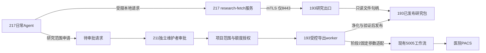

# 217受限研究数据下载设计

状态：用户已批准，阶段1已于2026-10-30实施并部署；多日增量也已实施（最长14天固定批准＋600秒续租、持久队列与故障续传）；当前能力、回归与明确差异见[阶段1交付](H217_RESEARCH_EXPORT_DEPLOYMENT_20261030.md)。下文保留完整设计蓝图，不代表原生DICOM/新PACS获取等后续阶段已经实现；尚无真实病例脱敏验收。

## 1. 结论与安全边界

新增193独立HTTPS研究出口（建议TCP8443，部署前验证端口空闲），不向217开放原5005服务，也不将5005按URL列表直接反向代理出去。217仅能获取指定项目、批准病例集合、指定格式和额度内的研究产物。193生产任务、管理配置、PACS连接和原始日志仍处于原维护域。

网络只区分地址和端口，不能可靠区分217上的程序。应用权限必须绑定服务身份和数据范围。Agent和下载代理若共用同一Unix账号及可读密钥，就无法阻止其他同账号程序复用凭据。因此217新增无登录、无sudo的`research-fetch`系统账号，由root管理其客户端密钥；日常Agent仅通过本地固定客户端/受控队列申请并领取已授权产物。mTLS认证下载代理，服务端授权进一步限制每个数据集；IP白名单只作附加条件。

威胁模型包含普通研究Agent越权、凭据误用、越过下载接口操作生产API、越权病例枚举、路径穿越、未脱敏文件混入、下载耗尽生产资源。拥有217 root/sudo的维护者仍可读取服务凭据、控制进程，这套方案不承诺防住宿主管理员；凭据即使失窃也只能在批准范围内使用，撤权须在193服务端生效。

## 2. 当前源码事实及复用边界

| 入口 | 观察 | 对设计的影响 |
|---|---|---|
| `src/web/app.py:process_single/process_batch` | 接受检查号及客户端options，创建PACS处理任务 | 不接收217任意检查号、options或回源目标；新获取须通过受限任务适配器 |
| `get_task_status` | 返回logs、result、error等完整对象 | 新接口重建字段白名单，不透传旧任务状态 |
| `download_result` | 根据task_id下载Excel/ZIP，未见数据集所有权校验 | UUID不是授权；不把task_id视为访问凭证 |
| `set_pacs_config/cache clear/cancel/log download` | 原服务包含配置修改、清理、取消及日志下载能力 | 新出口根本不实现这些操作，不做通配代理 |
| `src/utils/packaging.py:create_result_zip` | 遍历整理目录打包，除.processing_lock外不承担独立隐私白名单 | 建立专用export打包器，不能直接发送原ZIP |
| `src/core/metadata.py`、`dicom_tags/*.json` | Excel字段包含PatientID、AccessionNumber、StudyDate、UID及设备/描述字段 | 删除源DICOM、转换NII/NPZ不等于整包可直接发布；Excel、文件名等须独立处理 |
| `src/cli/download.py` | 提交single→轮询status→下载zip，基本API调用未见按客户端的授权参数 | 217使用新客户端协议，不能只替换SERVER_URL继续调用原API |

本结论是本机源码事实，不证明193当前每个文件与本机逐字一致；上线前应严格SSH核对部署版本和进程。已有几何、过滤、内存闸门和源文件清理决策保持，尤其不得为新增原生DICOM模式关闭既有NPZ源清理政策。

## 3. 架构

出口G无PACS凭据、无生产源码写权限、无sudo、无Docker socket、无localhost:5005或PACS网络访问能力，只读新的发布目录。worker W是另一个身份：仅有导出所需输入读取权限及独立暂存/发布权限，不运行Agent传入代码。193原访问资格不交给217。

阶段1不接入B：仅由维护者选定现有完成结果建立研究批次，复制到新暂存目录，重新脱敏及检查再发布。阶段2经单独具体实施审查后，worker才按批准清单调用固定内部适配器；共享生产队列的转换须服从既有并发、heavy_processing_slot、缓存指纹与几何/QC政策，不能直接起第二个无限制生产进程。

本设计不复用`prod_diagnose`作为导出写权限。已有0.2.0运维桥只允许固定诊断；如复用其审批/信箱机制，须新增独立`research_export_v1` profile、数据范围模型与动作白名单，不把已有诊断批准视为下载批准。Pi仅解释申请与结果，不批准或扩展范围。

## 4. 授权对象

建议按项目/批次授权，批准清单内自动执行，避免每个文件都要求人工确认。原生检查号清单由可信端导入，217默认只见研究用ID；如确需输入原检查号，使用独立受控申请流程，不能在公开查询或模型日志中传播。

一份不可由217修改的授权至少绑定：

- grant_id、project_id、dataset_id、version、client证书身份/公钥摘要；
- 明确病例/序列集合或冻结队列清单的摘要，不接受任意SQL、查询表达式、目录或正则；
- 允许的产物profile、元数据字段版本、像素处理/复核证据要求；
- 开始/到期时间、最大病例数、总实际传输字节、并发、速率与是否允许新PACS获取；
- 审批人、策略版本、撤销状态；新病例、格式或额度必须形成新版本/新授权。

初始建议值用于联调：一个批准批次、最多100例、客户端一条并发数据流、每日20GiB、速率上限5MiB/s，具体按193负载和研究需要调整。控制面权限每10分钟续领，批次批准窗口建议24小时；续领只能维持原范围。不是任何请求在24小时内都可生成任意量数据。

服务端每次请求都核对grant状态、证书绑定、项目和artifact归属；不能仅相信JWT自带claims或仅检查证书。控制面失联/授权数据库不可读时拒绝新访问。撤销后拒绝新Range和重试，并对长连接按不超过1秒/1MiB的节奏检查撤销和额度；已发出的数据无法远程收回，客户端服务端各自短期保留策略不等于能够撤回研究者已保存副本。

## 5. 新协议的最小接口

| 方法与路径 | 能力 | 边界 |
|---|---|---|
| POST `/v1/export-requests` | 提交批准名单/研究profile的申请引用 | 初期可不用HTTP，沿用受控信箱；只是提案，不启动生产 |
| GET `/v1/exports/{export_id}` | 查询本人授权批次状态 | 只返回状态、数量、容量及有限错误码 |
| GET `/v1/exports/{export_id}/manifest` | 获取当前发布版本的清单 | 研究ID、artifact_id、格式、大小、SHA256、策略/证据版本 |
| GET/HEAD `/v1/artifacts/{artifact_id}/content` | 下载明确产物，支持单段Range与If-Match | 要求该artifact属于本次授权的固定manifest；每次校验归属 |

初期不提供全库列表、患者检索、任意路径、URL回源、下载重定向、上传ZIP、Socket.IO、任务取消、生产状态、PACS配置、日志、缓存管理或通配`/api/*`。未知URL、方法或JSON字段统一拒绝。未授权ID查询使用一致404，避免跨项目枚举。

控制面状态：REQUESTED→APPROVED→BUILDING→VERIFYING→READY；失败进入HOLD/FAILED，可DENIED/REVOKED/EXPIRED。只有READY且授权有效才能发送数据。队列回复和状态中不透传原日志、异常正文、源任务结果对象、源路径或原检查号。

mTLS采用本地受控CA，193证书SAN与真实入口匹配，217校验服务器链和名称/IP；客户端证书单独吊销。短期下载凭证绑定客户端证书摘要、grant和artifact，放在Authorization头，不放查询参数/日志，也不302给第三方。源证书私钥和服务端CA私钥不交给Agent；如与现有CA共用，必须先明确隔离与撤销影响，默认用独立用途CA。

217本地代理仅接受固定project/export/artifact引用，拒绝调用方传URL、命令、Host、上游头或证书路径；通过SO_PEERCRED/固定用户组限制调用。只将批准文件写入项目规定目录，以*.partial接收、校验完成后原子重命名。受控服务即使被同主机普通程序调用，也只能请求服务端批准的数据，无法扩展到其他API。

## 6. 出口发布检查

默认设计覆盖当前研究产物NII/NPZ、重新生成的Excel及PNG。用户若需要真正的原生DICOM，启用另一个profile，不能直接返回现有源DICOM。

共同要求：

1. 新复制出的暂存目录与原结果/缓存分开，不原地清洗，不改变原几何或QC门槛。
2. 使用逐文件类型及字段白名单，排除DICOM源文件（默认profile）、日志、缓存、自由JSON、环境文件、脚本、凭据和未知文件。按manifest重新生成包，不递归打包生产目录。
3. PatientID、AccessionNumber、UID映射为项目域研究ID；出生日期去除或分箱，精确日期去除/一致偏移或按明确profile保留相对时间；同一患者的研究关联仅由可信端维护。研究ID采用项目域随机映射或HMAC，不用无密钥的原检查号hash。映射表和密钥只留193可信管理域，不放进包或217。
4. Excel逐sheet按白名单重建，包括Series_Summary，不能只删主sheet列；重新生成文件名/目录名并重写FileName/SampleFileName引用。SeriesDescription、ProtocolName、StationName等自由文本/设备信息需删除或受控归一化，不能因非姓名字段就默认安全。禁公式/宏/隐藏附表等未批准内容。
5. NIfTI清理description、aux_file、自由扩展和旁车；NPZ仅允许规定的数值数组/受控元数据，禁object/pickle、未知键和嵌入标识；PNG清理文本块/EXIF，元数据清理后也要验证像素内容。
6. 当前流程没有像素文字处理，不能仅以转换成功或BurnedInAnnotation=NO证明无像素内标识。首期只放行有适用性证据的模态/设备范围，文字风险未清除或未复核的图像进入HOLD；OCR用于筛查，不以“未检出文字”单独判安全。人工复核结果须绑定实际文件/像素摘要。
7. 若用途需要防止面部等可识别外观，单独定义适用范围/处理与科研影响，不能用“已删除标签”替代该评估。
8. 只有净化/几何/QC/文件引用与SHA检查全部通过才写READY并原子发布；失败隔离，不能降级返回原ZIP。旧缓存命中同样重新经过本导出检查，策略/转换/名单版本参与独立导出缓存键。

原生DICOM profile额外要求：依DICOM PS3.15的属性保密profile制定可执行清单，递归序列和私有属性处理、Study/Series/SOP UID及引用一致重映射、文件meta/preamble与DICOMDIR处理、像素/overlay文字检查，保持合法IOD及图像语义。不得为支持该profile破坏现有D24/D26清理规则；需要源对象的任务应走独立、授权的源捕获/脱敏分支并受保留期限控制，若原件已清理则明确不可复用，不能把源数据保留开关交给217。

参考：[DICOM PS3.15 Annex E](https://dicom.nema.org/medical/dicom/current/output/chtml/part15/chapter_E.html)。标准明确区分属性去标识与整个图像对象的隐私；本方案不以引用标准代替真实样本验证，也不声称当前实现已经符合该profile。

## 7. 数据面与运行隔离

- 187：仅新增217→193 TCP8443，绑定ether2→ether1，置于现有217→193整体TCP拒绝之前；5005与其他端口仍拒绝。先验证管理链路、保存定点回退，禁止宽放193整机。
- 217：只为下载服务放行193:8443。UFW目标端口许可不能独立区分程序；需额外受保护的UID/cgroup出站限制或等效隔离，且仍由mTLS和服务端对象授权兜底。不要把宿主整体ALLOW OUT误称为单程序许可。
- 193：新端口仅接收217源；mTLS/授权仍必需。出口专用UID与只读发布目录，限制出站、PID/内存/磁盘、请求时长、最大头与并发。不让出口访问5005/PACS或读取生产.env。
- 222：内网目标代理拒绝保持，避免另建绕行通道。新的HTTPS流量直接走187，不把193整机加进代理白名单。

发布数据使用独立新目录，例如`/srv/research-export/{staging,published,quarantine}`，路径及容量部署时核实，不暗示193已有此磁盘或足够容量。发布采用不可被出口修改的版本/只读视图，以artifact映射打开固定文件描述符；拒绝链接、路径穿越、绝对路径、任意文件名参数及特殊文件，消除发布后被替换的TOCTOU。下载时校验文件身份/大小与manifest绑定，发布worker不能在原版本原地重写。

Range必须绑定同一版本与强ETag；重复传输的实际字节同样计额度。限制单段Range/并发及重试预算，客户端以总SHA256验收，不靠ZIP扩展名判断成功。限速在应用/独立队列实施，不改生产全局带宽；控制/下载角色分别配额。

审计只记录研究ID、client/grant/export/artifact、操作、结果码、字节、耗时和策略版本。凭证、原始标识/临床日志不进下载侧审计。审计失败、撤权检查失效或发布验证失败时停止新增数据释放；已发布的合法请求也受授权到期和服务端可用性限制。

## 8. 验收与实施顺序

**阶段0：本设计与范围确认。** 明确真实DICOM/研究产物、允许数据范围、审批方式和像素风险处理。批准设计不等于批准修改生产或取真实病例。

**阶段1：离线合成夹具。** 先实现独立授权模型、发布清单校验、最小网关和217下载代理，使用植入标识的合成NIfTI/NPZ/Excel/PNG与合成DICOM。不连接5005/PACS。新模块与原应用解耦，不借机重构旧生产API。

**阶段2：受控已完成数据试点。** 经指定样本及发布范围批准后，193可信端导出现有完成结果，先测数据正确性/净化，再部署新端口精确规则；不重启现有5005。先1个批次，再决定扩大范围。

**阶段3：受控新获取。** 对独立research_export_v1授权与生产调度适配器做审查，再允许批准病例清单内的任务；新增病例/参数/来源不由217自行扩大。

最低验收矩阵：

- 无证书、错误证书、错误项目、错误artifact、过期/撤销授权、伪造审批、额外JSON字段均不能取数据；猜到task_id无效。
- 217直连193:5005及其他API、经222代理、改Host/方法/编码路径/重定向均不能绕过；新出口不存在管理路由且不能触达生产后端。
- 217普通研究用户不能读下载服务密钥；同机任意程序即使能访问8443也不能取得非授权数据；root维护者不纳入此隔离保证。
- 原始ID藏在Excel其他sheet、文件名、PNG文本、NIfTI扩展、NPZ对象/键、JSON旁车或ZIP嵌套中时被去除/拒绝；像素文字未验证时HOLD。
- 无文件变化时转换前后必要像素/几何身份保持；需要像素清洗时保留处理证据并验证科研指标，不以去标识理由静默损害诊断图像。
- READY前不可下载、发布文件替换或哈希不符拒绝、共享链接/硬链接/穿越不泄露；不把旧失败缓存升格READY。
- 断点续传/中断重试不串版本、不绕过额度；撤销能终止正在传输的流；达到并发/容量水位时拒绝或排队，原5005业务保持。
- 规则修改可定点回退；停止新出口并撤销8443放行即可关闭新能力，不依赖重启原服务。已下载内容不可通过撤权追回。

设计验收仅完成源码依据与逻辑检查，上述运行测试尚未执行。
